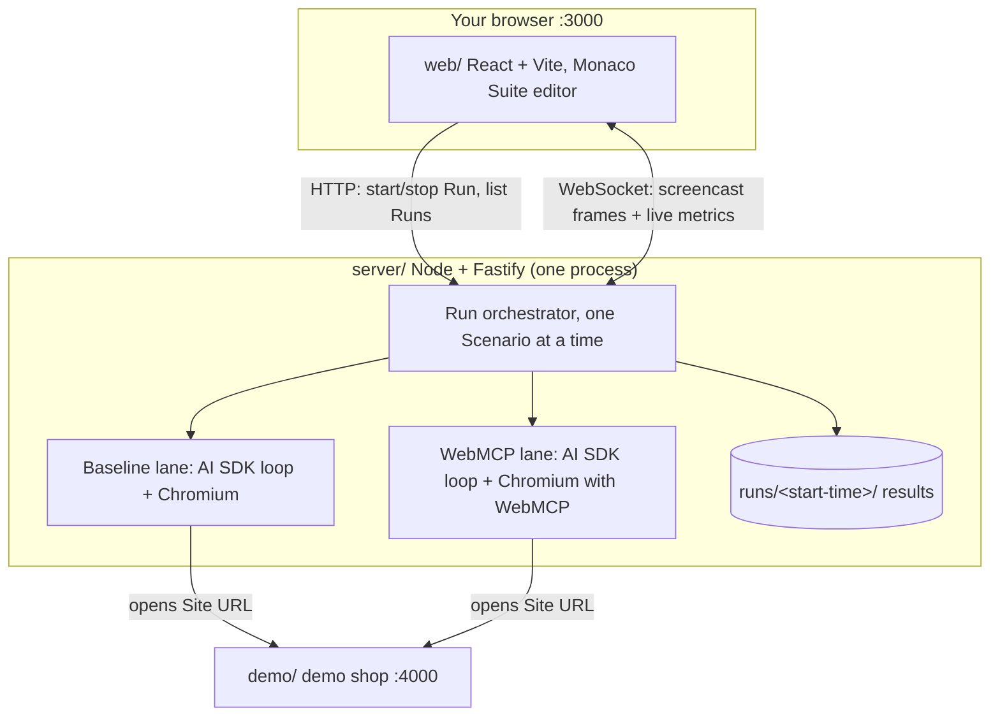

# Architecture

Update this file in the same pull request as any structural change. Detail and decisions: [docs/spec.md](docs/spec.md). Vocabulary: [GLOSSARY.md](GLOSSARY.md).

## Big picture



## Components

- **web/**: the UI (Setup, Live, Results). Talks to the server over HTTP and one WebSocket.
- **server/**: serves `web/`, validates the Suite, runs both Lanes, computes metrics and cost (`server/pricing`), writes `runs/`.
- **server/agent/**: the agent loop per Lane (Vercel AI SDK `streamText` once per Step), models, prompts, tool sets, key redaction.
- **server/lane/**: Playwright Chromium per Lane and the Browser tools.
- **demo/**: a separate demo shop that exposes WebMCP tools. It knows nothing of the app.
- **e2e/**: Playwright walkthrough of the UI, also recorded as the demo video.

## Key decisions

See [docs/adr](docs/adr) and the wayfinder map in GitHub Issues.

## Run and test

```bash
npm ci && npx playwright install chromium
npm run dev     # app :3000 + demo shop :4000
npm run lint && npm run typecheck && npm test
npm run e2e     # records e2e/test-results/**/video.webm
```
